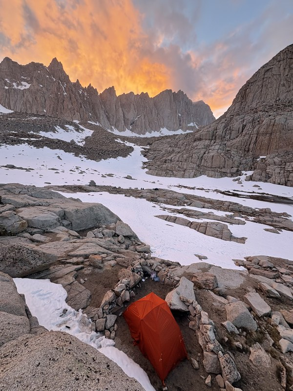
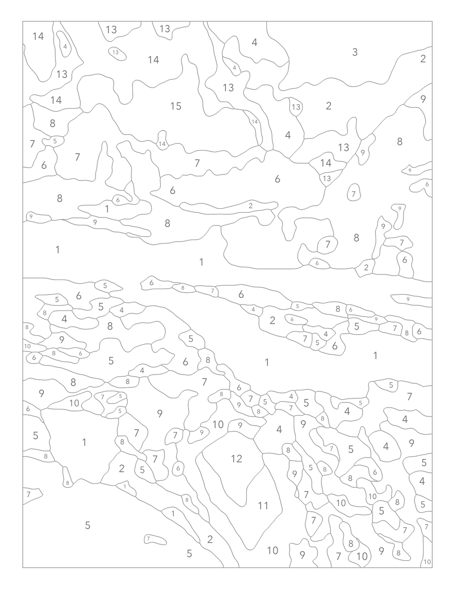
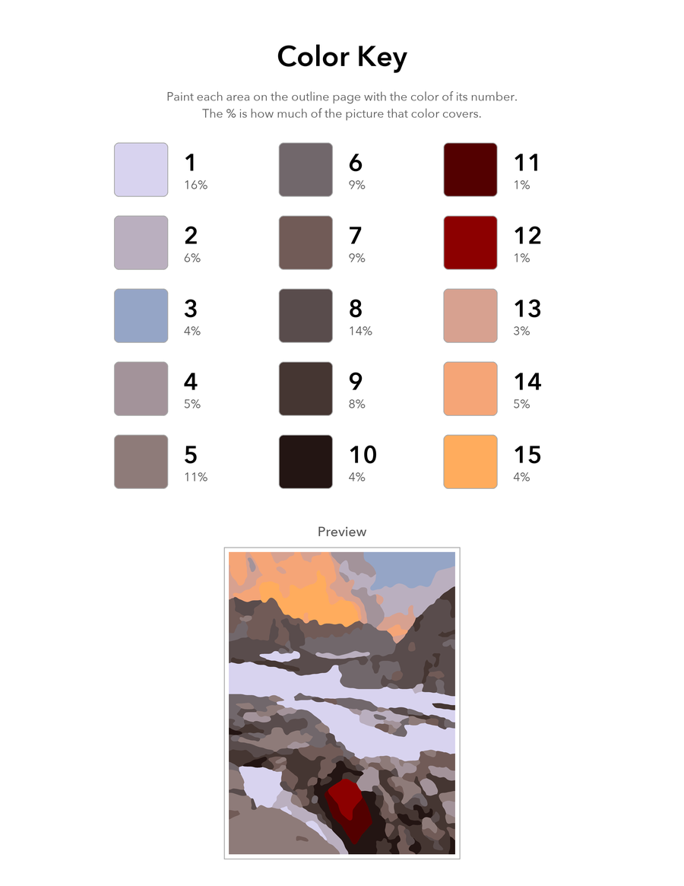

# pbn — photo to paint-by-number

Turns a photo into a printable paint-by-number PDF: a numbered outline page and a color key.
I built it to learn k-means clustering. The k-means is written from scratch in numpy.

| Photo | Outline | Color key |
|---|---|---|
|  |  |  |

Full example: [examples/tent_paint_by_number.pdf](examples/tent_paint_by_number.pdf)

## Usage

Requires [uv](https://docs.astral.sh/uv/).

```bash
uv sync
uv run pbn path/to/photo.jpg   # one photo (jpg, png, heic)
uv run pbn inputs/             # every photo in a folder
```

Each photo gets a folder in `outputs/` with `paint_by_number.pdf` and one debug image per step.
Print the PDF at **actual size**, not "fit to page".

## How it works

1. **Downsample + blur.** Resize to 300 px (LANCZOS), then apply a median filter to remove texture.
2. **K-means in CIELAB.** Reduce the image to k colors (k-means++ start). In Lab, distance matches how different colors look.
3. **Merge small regions.** Find connected regions and give each region below a minimum paper area the most common color around it.
4. **Smooth borders.** Upscale to 300 DPI, blur each color's mask, and give each pixel the color with the highest blurred value. Borders become curves, with no gaps between regions.
5. **Merge again.** Remove fragments from smoothing and regions too thin for a number.
6. **Render.** Draw borders and numbers. Each number goes at the point deepest inside its region (distance transform), and large regions get repeated numbers. Then draw the key.

## Settings

All settings are in [`src/pbn/config.py`](src/pbn/config.py). The most useful ones:

| Setting | Default | Effect |
|---|---|---|
| `k` | 15 | number of paint colors |
| `min_area_mm2` | 30 | smallest region on paper; lower = more detail, more painting |
| `smooth_sigma_mm` | 1.4 | border roundness |
| `palette_saturation`, `palette_contrast` | 1.3, 1.15 | make colors more intense and easier to tell apart; 1 = as in the photo |
| `page_mm`, `dpi` | US Letter, 300 | paper size |

## Tips

- Landscapes work best. Crop photos of people closely: small faces get merged away.
- Use heavy cardstock (~300 gsm) and acrylic paint.
- Text uses Avenir Next (macOS). On other systems, the text falls back to Pillow's default font.
